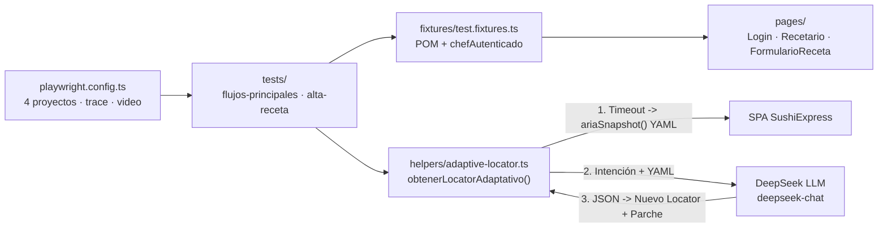

# Suite E2E Adaptativa — Playwright + IA Generativa

[](https://playwright.dev/)
[](https://www.typescriptlang.org/)
[](#matriz-de-ejecución)
[](#evidencia-de-ejecución)

Suite de pruebas automatizadas **End-to-End (E2E)** diseñada bajo principios de **QA adaptativo** para Single Page Applications (SPAs). Combina **Page Object Model (POM)**, **Fixtures personalizadas**, **locators semánticos orientados al usuario** y un mecanismo de **self-healing en tiempo de ejecución** basado en `ariaSnapshot()` + LLM (`deepseek:deepseek-chat`).

---

## Resumen Ejecutivo

En aplicaciones SPA modernas, el renderizado asincrónico, el enrutamiento client-side y los cambios frecuentes de plantilla rompen los scripts tradicionales acoplados al CSS. Esta suite resuelve ese problema mediante dos capas complementarias:

1. **Capa preventiva (Playwright nativo):** locators basados en roles y etiquetas accesibles (`getByRole`, `getByLabel`, `getByPlaceholder`), *auto-waiting* con *actionability checks* y aserciones *web-first* sin esperas fijas (`waitForTimeout`).
2. **Capa reactiva (Self-Healing asistido por IA):** ante el cambio de un selector en ejecución, `obtenerLocatorAdaptativo` captura el árbol de accesibilidad en formato YAML (`ariaSnapshot()`), consulta al LLM con la intención funcional del paso, recupera un locator semántico válido mediante JSON estructurado y registra en consola el parche exacto para actualizar el Page Object.

---

## Arquitectura de la Suite



---

## Flujos Cubiertos

| Flujo | Archivo | Alcance y Criterios Validados |
| :--- | :--- | :--- |
| **1. Autenticación y Control de Sesión** | `tests/flujos-principales.spec.ts` | Rechazo ante credenciales inválidas sin abandonar `/login` (`role="alert"`); login válido con redirección client-side a `/recetario`, persistencia de token en `sessionStorage`, visibilidad del usuario y botón `Añadir receta`. |
| **2. Búsqueda y Filtrado Reactivo** | `tests/flujos-principales.spec.ts` | Filtrado combinado por texto libre (`Salmón`) y categoría (`Rolls`) con aserciones `toHaveCount(2)` y `toContainText`, más validación de estado vacío informativo ante términos sin coincidencias. |
| **3. Alta de Registro + Self-Healing LLM** | `tests/alta-receta.spec.ts` | Validación negativa de formulario vacío (`alertaErrorCampos`), carga dinámica de listas de ingredientes y pasos con datos aislados por marca de tiempo, recuperación automática del botón renombrado (`Guardar borrador` → `Guardar ficha preliminar`) vía DeepSeek, verificación de red `POST /api/recetas → 201 Created` y persistencia en estado `Borrador`. |

---

## Matriz de Ejecución

Configurada en `playwright.config.ts` con `timeout: 30_000`, `expect.timeout: 5_000`, `trace: 'on'` y `video: 'on'`:

| Proyecto | Motor | Viewport | Objetivo |
| :--- | :--- | :---: | :--- |
| `chromium` | Desktop Chrome | `1280 × 720` | Motor principal y verificación de red/trazas |
| `firefox` | Desktop Firefox | `1280 × 720` | Compatibilidad cross-browser sobre Gecko |
| `webkit` | Desktop Safari | `1280 × 720` | Compatibilidad cross-browser sobre WebKit |
| `Mobile Chrome` | Pixel 5 | `390 × 844` | Validación de diseño responsivo y controles críticos visibles |

---

## Estructura del Repositorio

```text
.
├── fixtures/
│   └── test.fixtures.ts           # Inyección de POM y sesión autenticada (test.extend)
├── helpers/
│   └── adaptive-locator.ts        # Self-healing con ariaSnapshot() + DeepSeek (JSON estructurado)
├── pages/
│   ├── login.page.ts              # Page Object de /login
│   ├── recetario.page.ts          # Page Object de /recetario
│   └── formulario-receta.page.ts  # Page Object de /recetas/nueva
├── scripts/
│   ├── dev.mjs                    # Orquestador local de frontend + API
│   └── generar-casos.ts           # Generador en tiempo de diseño (ariaSnapshot -> 3 casos BDD)
├── tests/
│   ├── flujos-principales.spec.ts # Flujos 1 y 2
│   └── alta-receta.spec.ts        # Flujo 3 + adaptación dinámica con LLM
├── playwright-report/             # Reporte HTML interactivo generado
├── test-results/                  # Videos (.webm) y trazas (trace.zip) de los 4 proyectos
├── playwright.config.ts           # Matriz multi-navegador, timeouts y políticas de evidencia
├── proxy.conf.json                # Proxy /api -> backend local
├── .env.example                   # Plantilla de variables de entorno (sin credenciales)
└── package.json
```

---

## Puesta en Marcha

### 1. Instalación y configuración

```bash
npm install
npx playwright install chromium firefox webkit
```

Creá un archivo `.env` a partir de `.env.example` con tu clave de API:

```env
DEEPSEEK_API_KEY=sk-tu-api-key
LLM_MODEL=deepseek:deepseek-chat
LLM_BASE_URL=https://api.deepseek.com/v1
BASE_URL=http://localhost:4200
API_PORT=3001
```

### 2. Comandos principales

```bash
# Ejecutar la suite completa en los 4 proyectos configurados
npx playwright test

# Ejecutar solo en Chromium con navegador visible
npx playwright test --project=chromium --headed

# Abrir el Reporte HTML interactivo
npx playwright show-report

# Generar 3 casos BDD en tiempo de diseño a partir del ARIA Snapshot
npm run generate:cases
```

---

## Evidencia de Ejecución

Este repositorio incluye los artefactos generados en la corrida verificada (**12 passed** en los 4 navegadores):

- **Reporte HTML (`playwright-report/`):** resumen por archivo `.spec.ts` y navegador, tiempos por paso en milisegundos y acceso directo a trazas y videos.
- **Trazas interactivas (`test-results/**/trace.zip`):** línea de tiempo visual, snapshots de DOM `Before` / `After`, coordenada de `Action`, tráfico `Network` (`POST /api/recetas → 201 Created`) y `Console` sin errores.
  ```bash
  npx playwright show-trace test-results/alta-receta-Flujo-3-Alta-d-d7d8a-y-recupera-botón-renombrado-chromium/trace.zip
  ```
- **Videos (`test-results/**/video.webm`):** grabación automática de cada flujo en Desktop y Mobile.
